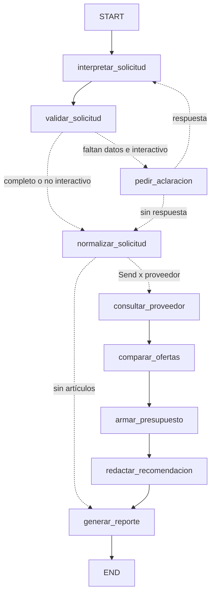

# Cotizador de compras de mercado con LangGraph

**Trabajo 4: Sistema de cotización y presupuesto de compra.** Dominio elegido: **Mercado** (alimentos, aseo y hogar).

Trabajo individual — [@susanatc00](https://github.com/susanatc00).

El usuario escribe una solicitud en lenguaje natural, por ejemplo:

> Necesito 5 kg de arroz, 2 litros de aceite y 3 kg de azúcar. Consulta dos supermercados y prepara un presupuesto para Medellín.

El sistema convierte la solicitud en una lista estructurada y consulta precios públicos en **Olímpica** y **Jumbo**. Después normaliza unidades, separa los productos equivalentes de los sustitutos y de los no comparables, y arma tres presupuestos: compra completa en cada tienda y compra combinada. Al final explica cuál conviene, con enlaces a cada fuente. Nunca toma un envío desconocido como cero.

- Orquestación: **LangGraph** (`StateGraph`, aristas condicionales, `Send` para consultar los proveedores en paralelo, `interrupt()` con checkpointer para pedir aclaraciones).
- Componentes LLM: **LangChain + OpenAI** con *Structured Outputs* (esquema JSON estricto validado con Pydantic).
- Herramientas programáticas: clientes web que respetan robots.txt, lectura de catálogos CSV, normalización de unidades y presupuesto.

---

## 1. Instalación y ejecución

Se gestiona con [uv](https://docs.astral.sh/uv/) (Python 3.11 o superior).

```bash
uv sync                      # crea .venv e instala dependencias según uv.lock
cp .env.example .env         # y pega tu OPENAI_API_KEY

uv run python main.py --texto "Necesito 5 kg de arroz, 2 litros de aceite y 3 kg de azúcar. Consulta dos supermercados y prepara un presupuesto para Medellín."
uv run python main.py                         # pregunta la solicitud por consola
uv run python main.py --no-interactivo ...    # no pregunta: registra suposiciones explícitas
uv run python main.py --fuente catalogo ...   # sin internet: usa el catálogo de referencia
uv run python main.py --sin-llm ...           # sin API key: reglas en lugar del LLM
uv run python main.py --sin-sustitutos ...    # los presupuestos solo usan equivalentes
uv run python main.py --mermaid               # imprime el grafo
uv run python main.py --capturar-catalogo arroz aceite azucar   # actualiza el CSV de referencia
uv run pytest                                 # 47 pruebas, sin red ni API
```

Cada ejecución imprime el reporte y guarda `salidas/presupuesto_<fecha>.md` (el reporte) y `.json` (todo el estado del grafo, para auditar la ejecución). En [`ejemplos/`](ejemplos/) hay tres ejecuciones reales del 9 de noviembre de 2026:

| Ejemplo | Qué muestra |
|---|---|
| [`01_enunciado.md`](ejemplos/01_enunciado.md) | La solicitud del enunciado. Cobertura completa en las dos tiendas; la compra combinada ahorra menos del 5 % y se recomienda una sola tienda. |
| [`02_restricciones_y_suposiciones.md`](ejemplos/02_restricciones_y_suposiciones.md) | Marca obligatoria (arroz Diana), especificación (aceite **de girasol**: las mezclas quedan como sustitutos), libras, docena, sin ciudad (se registra una suposición), pide Éxito (no soportado, se explica) y un detergente que una tienda no cotiza. |
| [`03_aclaracion_interactiva.md`](ejemplos/03_aclaracion_interactiva.md) | Solicitud sin cantidades ni ciudad. El grafo se detiene con `interrupt()`, pregunta, recibe la respuesta y vuelve a interpretar ([consola](ejemplos/03_aclaracion_interactiva.consola.txt)). |

## 2. Arquitectura: el grafo



El grafo generado por LangGraph está en [`docs/grafo.mmd`](docs/grafo.mmd).

| Nodo | Tipo | Qué hace | Archivo |
|---|---|---|---|
| `interpretar_solicitud` | **LLM** (salida estructurada) | Texto → `SolicitudInterpretada`: producto, término de búsqueda, cantidad, unidad, especificaciones, marca (obligatoria o preferida), presentación, ciudad y proveedores. Si falta un dato, devuelve `null`: no inventa. | `nodos.py`, `prompts.py` |
| `validar_solicitud` | Código | Detecta los datos imprescindibles que faltan: cantidad, unidad y ciudad. | `nodos.py` |
| `pedir_aclaracion` | Humano en el ciclo | `interrupt({"preguntas": [...]})`. `main.py` reanuda con `Command(resume=respuesta)`. Hace como máximo 2 rondas. | `nodos.py`, `main.py` |
| `normalizar_solicitud` | Código | Convierte todo a kg, L o unidades; registra **suposiciones explícitas** para lo que siga faltando; elige proveedores y explica los no soportados. | `nodos.py`, `unidades.py` |
| `consultar_proveedor` | Herramienta (en paralelo con `Send`) | Una rama por proveedor. Cada artículo se busca en la web pública o en el catálogo. | `proveedores/` |
| `comparar_ofertas` | **LLM** + código | El juez LLM clasifica cada oferta como equivalente, sustituto o no corresponde; el código lee el contenido del empaque, verifica restricciones y calcula el precio por unidad, los empaques, el costo y el excedente. | `comparacion.py` |
| `armar_presupuesto` | Código | Presupuesto por proveedor, compra combinada, costos adicionales y regla de recomendación. | `presupuesto.py` |
| `redactar_recomendacion` | **LLM** | Explica la recomendación usando **solo** cifras ya calculadas por el código. | `nodos.py`, `prompts.py` |
| `generar_reporte` | Código | Reporte Markdown y JSON. | `reporte.py` |

El estado (`EstadoCotizacion`, en `schemas.py`) es un modelo Pydantic. `historial`, `suposiciones` y `resultados_consulta` usan un *reducer* (`operator.add`), así las ramas paralelas acumulan sus resultados sin pisarse.

**Inyección de dependencias** (el mismo patrón de `sistema_quejas`): `construir_grafo(interprete=, juez=, redactor=, registro=)` recibe los LLM y los proveedores. En producción son OpenAI y la web; en las pruebas son reglas, un LLM falso y catálogos locales. Si OpenAI falla durante una ejecución, el juez y el redactor pasan a las reglas de respaldo y lo registran en la traza.

## 3. Fuentes de precios y cumplimiento de condiciones de uso

| Proveedor | Mecanismo | Detalle |
|---|---|---|
| **Olímpica** (olimpica.com) | Datos estructurados schema.org (JSON-LD) en páginas públicas | `/{termino}?map=ft`, luego `/{plural}` y, si nada de eso trae productos, la categoría tomada de su sitemap público. |
| **Jumbo** (jumbocolombia.com) | Igual | Igual. |
| **Catálogo de referencia** | Importación de CSV | [`data/catalogos/referencia_mercado.csv`](data/catalogos/referencia_mercado.csv): 559 productos capturados de las dos tiendas el 2026-11-09, cada uno con URL y fecha. Se usa con `--fuente catalogo` o como respaldo automático si la web falla. El reporte lo marca como «Catálogo de referencia». |

Las páginas de búsqueda de las dos tiendas publican un `ItemList` schema.org con nombre, marca, SKU, precio, moneda, disponibilidad y URL de cada producto. Es el mismo dato que leen los buscadores. Cada oferta conserva **nombre, presentación, precio, moneda, proveedor, URL, SKU, fecha de consulta y disponibilidad**.

Reglas que aplica el cliente web (`proveedores/web_jsonld.py`):

1. **robots.txt antes de cada URL.** Se usa un intérprete propio del RFC 9309 (`proveedores/robots.py`, con pruebas): soporta los comodines `*` y `$`, y gana la regla más larga. Las librerías estándar fallan aquí: `urllib.robotparser` ignora los comodines, y `protego` interpreta la regla `Disallow: /*%` de Olímpica como si bloqueara cualquier URL con `?`, cuando en el RFC el `%` es literal.
2. **Solo páginas HTML públicas.** No se usan endpoints internos (`/api/`, `/_v/`, `/busca`), sesiones, cookies, carrito ni checkout, ni se simula un navegador. El User-Agent identifica el proyecto.
3. **Tasa limitada.** Espera 1,5 s entre peticiones al mismo sitio (o el `Crawl-delay` si es mayor) y guarda en caché lo descargado durante la ejecución. Si una página llega sin el bloque JSON-LD, lo que pasa de vez en cuando en Olímpica, la reintenta **una** vez.

**Tiendas descartadas y por qué** (se explican al usuario si las pide; ver `config/proveedores.json`):

- **Éxito y Carulla:** las páginas públicas no traen los productos. El navegador los pide a `/api/`, un endpoint interno, y el enunciado prohíbe tratar endpoints internos como API pública. Usar Playwright no lo resuelve, porque igual se consumiría ese endpoint.
- **D1, Ara y Makro:** no publican resultados en datos estructurados.

**¿Y Playwright?** No hizo falta. Las dos tiendas elegidas publican los datos en el HTML que entrega el servidor. El enunciado lo permite "cuando sea necesaria", y aquí no lo fue.

## 4. Normalización y comparación

**Unidades** (`unidades.py`): g, kg, lb y oz pasan a kg; mL, L y cc pasan a L; los conteos (und, rollos, x30) pasan a unidades. Una libra se toma como 500 g (uso comercial en Colombia) y queda registrado como suposición. El contenido del empaque se lee del nombre del producto, porque las tiendas no lo publican como dato aparte:

| Nombre publicado | Lectura |
|---|---|
| `Arroz Diana blanco x5kg` | 5 kg |
| `ARROZ TAILANDES 2.500 G` | 2,5 kg (en gramos, el punto separa miles) |
| `Arroz Diana blanco x25und x500g c-u` | 25 × 0,5 kg = 12,5 kg |
| `Arroz Olimpica Paca Económica 500 G X25 Unds` | 25 × 0,5 kg = 12,5 kg (*inferida*) |
| `Arroz Diana Paca 12,5 Kg X25 Unds` | 12,5 kg en total (*inferida*: 25 × 12,5 kg superaría el umbral de 50 kg) |
| `Leche Entera Colanta Bolsa x6 Und x1000ml` | 6 × 1 L = 6 L |

Las presentaciones *inferidas* se marcan en el reporte para que el usuario las confirme. Masa y volumen no se convierten entre sí, porque eso exige conocer la densidad.

**Clasificación de cada oferta:**

| Clasificación | Regla | ¿Entra al presupuesto? |
|---|---|---|
| **Equivalente** | El juez LLM dice que es el mismo producto y cumple las especificaciones. La marca y el tamaño no cambian la categoría. | Sí |
| **Sustituto** | Mismo uso, otra variedad o calidad: arroz integral o basmati por arroz; aceite de oliva o mezcla si se pidió girasol; azúcar morena. | Solo si no hay equivalente en esa opción. Se marca en la tabla y en los pendientes. Con `--sin-sustitutos`, nunca. |
| **No comparable** | Sin precio, moneda distinta de COP, contenido ilegible o unidad no convertible (por ejemplo, stevia líquida en mL cuando se pidieron kg). | No |
| **Descartado** | No es el producto pedido: panela por azúcar, galletas, arroz con pollo. | No (se cuenta, no se lista) |

Restricciones del usuario (código, en `comparacion.py`):
- **Marca:** si es *obligatoria*, la oferta de otra marca no es elegible. Si es *preferida*, solo se anota.
- **Presentación:** si es obligatoria, el empaque (o la unidad del multipack) debe coincidir con una tolerancia de ±2 %.
- **Agotado:** la oferta no es elegible.

**Cantidad a comprar:** `empaques = ⌈cantidad pedida / contenido del empaque⌉`, `costo = empaques × precio`. Además se reporta el excedente. Para cada artículo se elige la oferta de **menor costo total**, no la de menor precio unitario: comprar 10 kg para cubrir 5 kg no gana solo por ser más barato por kg.

## 5. Presupuesto y recomendación

- **Por proveedor:** la mejor oferta elegible de cada artículo en esa tienda, con cobertura *completa*, *completa con sustitutos*, *parcial* o *nula*.
- **Compra combinada:** la mejor oferta de cada artículo entre todas las tiendas. Solo es viable si usa dos o más tiendas; si no, coincide con una compra en una sola tienda.
- **Costos adicionales:** el envío de cada tienda usada. El costo del domicilio depende de la dirección y solo se calcula en el checkout, que no se consulta, así que su valor es `null` y se muestra como **desconocido**.
- Cada opción separa el **subtotal de productos**, el **total con costos conocidos** y el **total final confirmado**. Este último solo se muestra si no queda nada pendiente: envío conocido, cobertura completa y sin sustitutos. En otro caso aparece **«No confirmado»** junto con la lista de lo que falta.
- **Regla de recomendación** (`presupuesto.recomendar`, determinista):
  1. Gana la mayor cobertura.
  2. A igual cobertura, gana el menor total conocido.
  3. La compra combinada solo se recomienda si ahorra **5 % o más** frente a la mejor tienda única, porque cada pedido extra suma un envío de costo desconocido.

  El LLM redactor explica la decisión, pero no la toma ni calcula cifras: recibe las diferencias ya calculadas.

## 6. Pruebas

`uv run pytest` ejecuta 47 pruebas sin red ni API (LLM falso, catálogos de prueba y un cliente HTTP falso):

- `test_unidades.py`: lectura de presentaciones con nombres reales de las dos tiendas y conversión de unidades.
- `test_proveedores.py`: robots.txt (casos reales de Olímpica y Jumbo), extracción JSON-LD, ruta por sitemap, reintento, catálogo y selección de proveedores.
- `test_comparacion_presupuesto.py`: clasificación, restricciones, empaques, envío desconocido frente a conocido, umbral de la compra combinada y sustitutos.
- `test_grafo.py`: grafo completo con `Send`, `interrupt` y reanudación, suposiciones, proveedor no soportado, juez que falla, producto sin cotización y marca obligatoria.

## 7. Limitaciones conocidas

- **Precios por ciudad:** las tiendas muestran el precio de su tienda en línea sin elegir sede. No se verificó que sea el mismo en la ciudad pedida; el reporte lo declara como condición no verificada.
- **Cobertura de búsqueda:** solo se lee la primera página de resultados (15 a 28 productos). Algunos términos no tienen página con datos estructurados en una tienda (por ejemplo, «sal» o «detergente» en Olímpica) y quedan *sin cotización*.
- **Contenido del empaque:** se lee del nombre con reglas. Los casos ambiguos se marcan como *inferidos*.
- **Promociones condicionadas** (tarjeta propia, «lleve X pague Y») no se consideran.
- **Envío:** siempre desconocido, porque solo se calcula en el checkout. Si una tienda publicara una tarifa fija, basta con poner su `valor` en `config/proveedores.json`.
- El modo `--sin-llm` usa reglas simples: sirve para pruebas y demostración, pero entiende menos que el LLM.

## 8. Estructura

```
cotizador-compras/
├── main.py                       # CLI: construye el grafo, maneja interrupt/resume, captura el catálogo
├── config/proveedores.json       # proveedores, mecanismo, envío, condiciones y tiendas no soportadas
├── data/catalogos/               # catálogo de referencia (CSV con URL y fecha de captura)
├── cotizador/
│   ├── schemas.py                # modelos Pydantic: salidas LLM, ofertas, presupuesto, estado
│   ├── grafo.py                  # StateGraph, Send, checkpointer
│   ├── nodos.py                  # los 9 nodos (fábricas con dependencias inyectadas)
│   ├── prompts.py / llm.py       # intérprete, juez y redactor (OpenAI, Structured Outputs)
│   ├── reglas.py                 # equivalentes por reglas (--sin-llm y pruebas)
│   ├── unidades.py               # lectura de presentaciones y conversión
│   ├── comparacion.py            # clasificación y cálculos por oferta
│   ├── presupuesto.py            # opciones de compra y regla de recomendación
│   ├── reporte.py                # Markdown + JSON
│   └── proveedores/              # web JSON-LD, robots.txt RFC 9309, catálogo, registro
├── tests/                        # 47 pruebas (pytest)
├── ejemplos/                     # 3 ejecuciones reales (.md, .json y salida de consola)
└── docs/grafo.mmd                # grafo generado por LangGraph
```

Variables de entorno: ver [`.env.example`](.env.example). El modelo por defecto es `gpt-4.1-mini` y se puede cambiar con `OPENAI_MODEL`. Para ver las trazas en LangSmith, poner `LANGSMITH_TRACING=true`.
